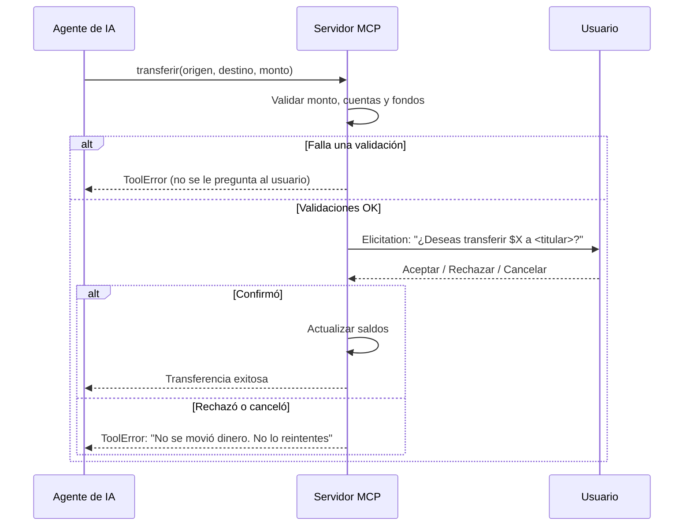

# AprenderMCP — Servidor MCP de operaciones bancarias

Servidor [Model Context Protocol (MCP)](https://modelcontextprotocol.io) en Python que permite a un agente de IA **consultar saldos y transferir dinero entre cuentas simuladas**, con **confirmación humana obligatoria** antes de mover dinero.

Lo construí para aprender MCP de punta a punta: cómo un servidor expone *tools*, *resources* y *prompts*, cómo pedirle confirmación al usuario en medio de una llamada (*elicitation*) y cómo testear todo sin levantar un cliente real.

> Los datos son ficticios y viven en memoria (dos cuentas de ejemplo). No hay conexión con ningún banco.

## Qué expone el servidor

| Tipo | Nombre | Qué hace |
|---|---|---|
| Tool (solo lectura) | `consultar_saldo` | Devuelve el titular y el saldo de una cuenta `CTA-XXX`. |
| Tool (destructiva) | `transferir` | Mueve dinero entre dos cuentas, **solo si el usuario lo confirma**. |
| Resource | `banco://reglamento` | Reglas del banco: límite por transferencia, no transferir a la misma cuenta, confirmación obligatoria. |
| Prompt | `planificar_transferencia` | Guía al agente para revisar saldo y reglas, y proponer un plan (por ejemplo, dividir un monto que excede el límite) **antes** de llamar a `transferir`. |

Las tools llevan *annotations* (`readOnlyHint`, `destructiveHint`, `idempotentHint`, `openWorldHint`) para que el cliente sepa cuáles modifican datos.

## Flujo de una transferencia



Decisiones de diseño:

- **Validar antes de preguntar.** El *resolver* `pedir_confirmacion` corre antes del cuerpo de la tool. Si el monto supera el límite ($200.000), si las cuentas no existen, si son la misma o si no hay fondos, devuelve el error de inmediato y **nunca le muestra el formulario al usuario**.
- **La confirmación es del humano, no del agente.** El formulario de *elicitation* muestra el titular de destino para que el usuario sepa a quién le transfiere.
- **Errores pensados para el agente.** Los mensajes de `ToolError` dicen qué falló y qué hacer: el formato esperado del ID (`CTA-001`), el saldo disponible, o "no lo reintentes a menos que el usuario lo indique".
- **Una sola fuente de verdad.** El límite por transferencia es una constante que usan la validación, la descripción de la tool, el reglamento y el prompt.
- **Entradas normalizadas.** `" cta-001"` se interpreta como `CTA-001`.

## Requisitos

- Python 3.12
- [uv](https://docs.astral.sh/uv/)
- SDK oficial de MCP para Python (`mcp[cli]` ≥ 2.3), que se instala con `uv sync`

## Instalación y uso

```bash
git clone https://github.com/wawa1806/AprenderMCP.git
cd AprenderMCP
uv sync
```

**Correr el servidor** (transporte stdio):

```bash
uv run aprendermcp
```

**Probarlo con MCP Inspector** (interfaz web para llamar tools, leer resources y probar prompts; requiere Node.js):

```bash
uv run mcp dev src/aprendermcp/server.py
```

**Conectarlo a Claude Code:**

```bash
claude mcp add banco -- uv --directory /ruta/a/AprenderMCP run aprendermcp
```

Luego puedes pedirle, por ejemplo, *"¿cuánto saldo tiene la CTA-001?"* o *"transfiere $300.000 de la CTA-001 a la CTA-002"*. En el segundo caso el agente debería usar el reglamento para notar que excede el límite y proponer dividirlo. Para ver el formulario de confirmación, el cliente debe soportar *elicitation*.

## Tests

```bash
uv run pytest
```

Hay 15 tests con pytest (asíncronos, vía `anyio`). Usan un **cliente MCP en memoria** conectado directo al servidor, con un *usuario simulado* que responde el formulario de confirmación (aceptar, rechazar o cancelar). Cubren:

- consulta de saldo de cuentas existentes e inexistentes, y normalización del ID;
- que **no se mueva dinero** si el usuario rechaza, cancela o no marca la confirmación;
- que una transferencia confirmada actualice ambos saldos;
- que las validaciones (límite, cuenta inexistente, misma cuenta, fondos insuficientes) fallen **sin mostrar el formulario**;
- que el formulario muestre el titular de destino;
- el contenido del resource `banco://reglamento` y la estructura del prompt;
- que la descripción de `transferir` que ve el agente muestre el límite real (se arma desde la constante, no está escrito a mano).

Un *fixture* guarda y restaura las cuentas en cada test, así que los tests no dependen entre sí.

## Estructura

```
AprenderMCP/
├── src/aprendermcp/
│   └── server.py      # servidor MCP: tools, resource, prompt y elicitation
├── tests/
│   ├── conftest.py    # cliente MCP en memoria y usuario simulado
│   └── test_banco.py  # 15 tests
└── pyproject.toml
```

## Autor

Lukas Estay, Ingeniero Civil Biomédico (Universidad de Concepción). [LinkedIn](https://www.linkedin.com/in/lukas-estay) · [GitHub](https://github.com/wawa1806)
